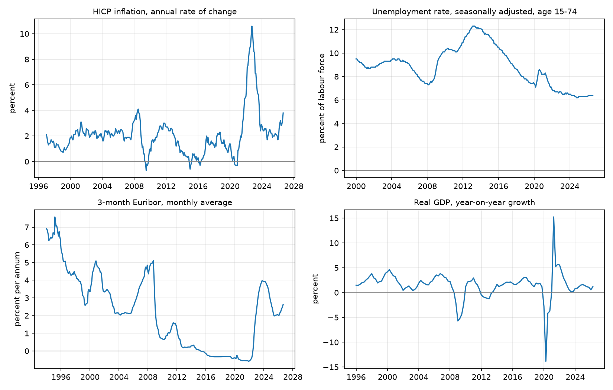
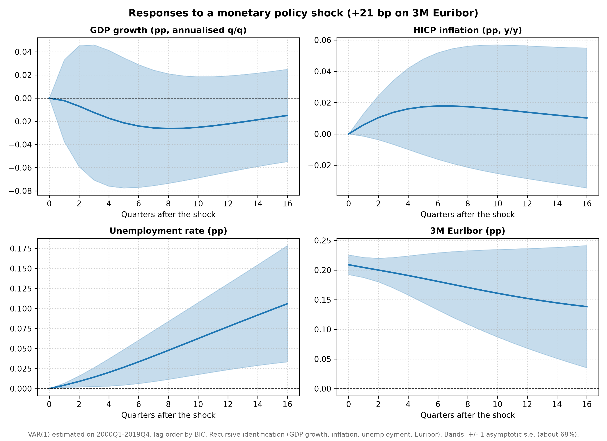
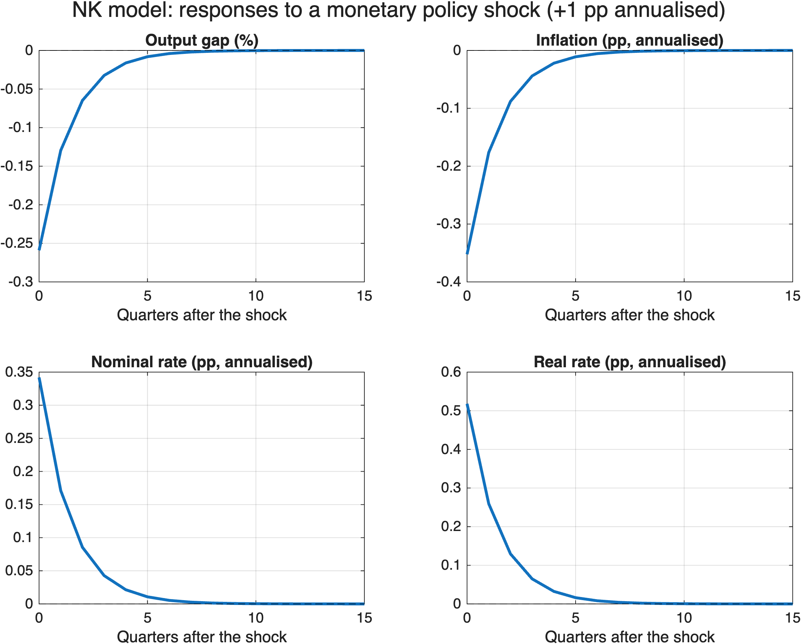

# Euro Area Macro Forecasting


Forecasting euro area GDP growth and inflation with univariate, multivariate, Bayesian and machine learning models, evaluated in a pseudo-out-of-sample exercise, together with the effects of a monetary policy shock in a recursive VAR and in a three-equation New Keynesian model solved in Dynare.

**What the project covers**

- **Data pipeline:** four euro area series downloaded from the ECB Data Portal API and stored in a SQLite database
- **Forecasting models:** random walk, AR, VAR, Bayesian VAR with a Minnesota prior (written from scratch in NumPy) and random forest
- **Forecast evaluation:** expanding-window pseudo-out-of-sample forecasts at 1, 4 and 8 quarters, with an explicit treatment of the Covid period
- **Monetary policy:** impulse responses to a monetary policy shock from a recursive VAR and from a New Keynesian model in Dynare
- **Testing:** automated tests on GitHub Actions at every push

## Data

All series come from the [ECB Data Portal](https://data.ecb.europa.eu/) and are stored in a SQLite database with two tables (`series` for metadata, `observations` for values; revised values overwrite old ones).

| Series | ECB key | Frequency | Unit |
|---|---|---|---|
| HICP inflation | `HICP.M.U2.N.000000.4D0.ANR` | monthly | annual rate of change, % |
| Unemployment rate | `LFSI.M.I10.S.UNEHRT.TOTAL0.15_74.T` | monthly | % of labour force |
| 3-month Euribor | `FM.M.U2.EUR.RT.MM.EURIBOR3MD_.HSTA` | monthly | % per annum |
| Real GDP | `MNA.Q.Y.I10.W2.S1.S1.B.B1GQ._Z._Z._Z.EUR.LR.N` | quarterly | EUR millions, chain-linked volumes |

Monthly series are converted to quarterly averages, keeping only complete quarters; GDP growth is the annualised quarterly log change (400·Δln GDP). The estimation sample runs from 2000Q1 to 2026Q2 (106 quarters).



## Forecast evaluation

**Design.** At every origin from 2009Q4 onwards, each model is estimated on all data available up to that quarter (expanding window) and forecasts GDP growth and inflation 1, 4 and 8 quarters ahead. Accuracy is measured by the root mean squared error (RMSE). Forecasts whose origin or target falls in 2020Q1–2021Q4 are excluded from the RMSE: the Covid swings (GDP growth of about −47% and +44% annualised) would otherwise dominate every statistic.

**Models.**

| Model | Description |
|---|---|
| Random walk | the last observed value |
| AR | univariate autoregression, lag order chosen by BIC (up to 8) |
| VAR | four-variable VAR, lag order chosen by BIC (1 to 4), OLS |
| BVAR | four-variable VAR with four lags and a Minnesota prior (overall tightness λ = 0.2, cross-variable tightness θ = 0.5); prior mean of one on the own first lag for inflation, unemployment and the Euribor, zero for GDP growth; posterior mean computed equation by equation in NumPy |
| Random forest | direct multi-step forecasts: one forest (300 trees, default hyperparameters, fixed seed) per variable and horizon, using the current value and three lags of all four variables |

**Results.** RMSE relative to the AR (values below 1 mean the model beats the AR), excluding Covid:

| | GDP h=1 | GDP h=4 | GDP h=8 | Inflation h=1 | Inflation h=4 | Inflation h=8 |
|---|---|---|---|---|---|---|
| VAR | 1.80 | 1.51 | 1.47 | 0.86 | 0.84 | 0.83 |
| BVAR | 1.57 | 1.57 | 1.53 | 0.86 | 0.86 | 0.84 |
| Random forest | 1.51 | 4.28 | 3.40 | 1.48 | 0.68 | 0.53 |
| *AR RMSE (level)* | *1.25* | *1.40* | *1.41* | *0.66* | *2.06* | *2.53* |

Origins up to 2019Q4 only, so that no Covid quarter enters the estimation sample:

| | GDP h=1 | GDP h=4 | GDP h=8 | Inflation h=1 | Inflation h=4 | Inflation h=8 |
|---|---|---|---|---|---|---|
| VAR | 1.23 | 1.28 | 1.18 | 0.69 | 0.51 | 0.51 |
| BVAR | 1.34 | 1.43 | 1.24 | 0.68 | 0.55 | 0.55 |
| Random forest | 0.96 | 1.23 | 1.57 | 0.88 | 0.58 | 0.52 |

**Findings.**

- **GDP growth is hard to beat with a simple AR.** No multivariate model improves on it consistently; the only exception is the random forest one quarter ahead before 2020 (0.96). Restricting origins to 2019Q4 or earlier lowers the VAR's relative RMSE from 1.47–1.80 to 1.18–1.28, which is consistent with both over-parameterisation in a short sample and contamination of the estimated dynamics by the 2020 outliers.
- **Multivariate information helps for inflation.** The VAR lowers the RMSE by 14–17% relative to the AR over the whole evaluation period and by 31–49% before 2020; part of the advantage is lost after 2022, when the inflation surge was driven by energy and supply factors outside the model.
- **BVAR.** With standard Minnesota hyperparameters the BVAR performs close to the BIC-selected VAR: it retains the VAR's gain for inflation (14–16% lower RMSE than the AR) but, like the VAR, does not beat the AR for GDP growth (1.53–1.57). A sensitivity analysis on λ reveals a trade-off. A tighter prior improves GDP forecasts monotonically (1.15–1.26 at λ = 0.05) but erodes the inflation gains (0.97–1.35), especially at the two-year horizon. A looser prior does the opposite (at λ = 0.5: 1.89–2.09 for GDP, 0.69–0.88 for inflation). A single overall tightness cannot serve both equations. Hyperparameters were not tuned on the evaluation sample, so the best value in the sensitivity table should not be read as the model's performance.
- **Random forest.** The results are the most mixed. For inflation it is the most accurate model at one- and two-year horizons (RMSE 32–47% below the AR), but one quarter ahead it does worse than the AR (1.48), consistent with the fact that a tree cannot predict values outside the range seen in estimation, while inflation rose well above that range in 2022. For GDP growth it is the worst model once the Covid quarters enter the training sample (3.40–4.28 at one and two years), plausibly because with so few observations single extreme values end up in the leaves of the trees. Before 2020 it is close to the AR one quarter ahead and worse at longer horizons.
- **Caveats.** The random walk is hard to beat for inflation (AR/RW between 0.98 and 1.16), in line with Atkeson and Ohanian (2001). Differences in RMSE have not been tested for statistical significance (e.g. Diebold-Mariano), and samples are short.

## Monetary policy shock

### Recursive VAR



A one-standard-deviation monetary policy shock (+21 bp on the 3-month Euribor; recursive identification with the ordering GDP growth, inflation, unemployment, Euribor; VAR(1) estimated on 2000Q1–2019Q4) raises unemployment gradually, by about 0.1 pp after four years: the only response clearly different from zero at the 68% level. GDP growth falls slightly, with a trough of about −0.03 pp after two years, but the estimate is imprecise. Inflation rises slightly instead of falling, the price puzzle typical of small recursive VARs (Sims, 1992), and is also not distinguishable from zero. The shock is very persistent, with two thirds of it still present after four years, reflecting the near-unit-root behaviour of the Euribor over the sample. Bands are asymptotic (±1 standard error) and do not correct the small-sample bias of persistent VARs (Kilian, 1998). Recursive identification with a short-term rate as the policy indicator is a clear limitation, especially after 2014, when policy worked mainly through asset purchases and forward guidance; high-frequency identification (Jarociński and Karadi, 2020) addresses this.

### Three-equation New Keynesian model (Dynare)



The model in [`dynare/nk3.mod`](dynare/nk3.mod) contains a New Keynesian Phillips curve, a dynamic IS curve and a Taylor rule with an AR(1) monetary policy shock, calibrated as in Galí (2015, ch. 3). A shock of 25 bp per quarter (1 pp annualised) lowers the output gap by 0.26% and annualised inflation by 0.35 pp on impact. The nominal rate rises by only 0.34 pp, because the policy rule responds to the fall in inflation and output, while the real rate rises by 0.52 pp. The Dynare solution matches the closed-form solution obtained with the method of undetermined coefficients. Setting the inflation coefficient of the Taylor rule below one (φπ = 0.9) violates the Taylor principle: Dynare finds one unstable eigenvalue for two forward-looking variables, so the Blanchard-Kahn conditions fail (indeterminacy).

**VAR versus NK model.** Unlike the VAR, the model produces no price puzzle, since the sign of the inflation response is imposed by theory. It also has no internal propagation: all variables inherit the persistence of the shock (ρ = 0.5) and are back near steady state within about six quarters, whereas the VAR responses are far more persistent.

## Tests

The tests run on GitHub Actions at every push and need neither an internet connection nor the database:

- `test_download.py`: URL construction and cleaning of the ECB CSV, with the API replaced by a fake response
- `test_database.py`: schema, metadata, round trip of observations, overwriting of revised values and foreign-key constraint, on a temporary database
- `test_dataset.py`: conversion of monthly series to quarterly averages over complete quarters
- `test_models.py`: alignment of the lag matrix, equivalence between the BVAR with a flat prior and the OLS VAR, and output format of every model
- `test_environment.py`: Python version and required packages

## Reproducing the results

```bash
python3 -m venv .venv
source .venv/bin/activate
pip install -r requirements.txt
pytest                              # run the tests
python -m scripts.build_database    # download the series and build data/processed/ea_macro.db
python -m scripts.plot_series       # figures/ea_macro_series.png
python -m scripts.evaluate          # forecast evaluation (the random forest takes a few minutes)
python -m scripts.var_irf           # figures/var_irf_monetary.png
```

The New Keynesian model requires MATLAB with Dynare: from the `dynare/` folder, run `plot_nk3_irf` to solve the model and save `figures/nk3_irf_monetary.png`.

## Repository structure

```
src/        download.py (ECB API), database.py (SQLite), dataset.py (quarterly dataset),
            models.py (forecasting models), evaluation.py (pseudo-out-of-sample evaluation)
scripts/    entry points: database, figures, evaluation, VAR impulse responses
dynare/     New Keynesian model (nk3.mod) and plotting script
figures/    charts used in this README
tests/      automated tests
```

## Possible extensions

- Treat the Covid observations explicitly in estimation, e.g. by rescaling the shock volatility as in Lenza and Primiceri (2022)
- Choose the BVAR hyperparameters by maximising the marginal likelihood (Giannone, Lenza and Primiceri, 2015)
- Bias-corrected bootstrap bands for the impulse responses (Kilian, 1998)
- Diebold-Mariano tests of equal predictive accuracy

## References

- Atkeson, A. and Ohanian, L. (2001). Are Phillips curves useful for forecasting inflation? *Federal Reserve Bank of Minneapolis Quarterly Review*.
- Galí, J. (2015). *Monetary Policy, Inflation, and the Business Cycle*, 2nd ed. Princeton University Press.
- Giannone, D., Lenza, M. and Primiceri, G. (2015). Prior selection for vector autoregressions. *Review of Economics and Statistics*.
- Jarociński, M. and Karadi, P. (2020). Deconstructing monetary policy surprises: the role of information shocks. *American Economic Journal: Macroeconomics*.
- Kilian, L. (1998). Small-sample confidence intervals for impulse response functions. *Review of Economics and Statistics*.
- Koop, G. and Korobilis, D. (2010). Bayesian multivariate time series methods for empirical macroeconomics. *Foundations and Trends in Econometrics*.
- Lenza, M. and Primiceri, G. (2022). How to estimate a vector autoregression after March 2020. *Journal of Applied Econometrics*.
- Litterman, R. (1986). Forecasting with Bayesian vector autoregressions: five years of experience. *Journal of Business & Economic Statistics*.
- Sims, C. (1992). Interpreting the macroeconomic time series facts: the effects of monetary policy. *European Economic Review*.

## Use of AI tools

The project was developed with the help of an AI assistant, used for explanations of the methods, code review and debugging, and for drafting parts of the code and of this README. Modelling choices, checks and interpretation of the results are my own.

## Author

Luca Rigoni, MSc student in Economics (QEM), Ca' Foscari University of Venice
